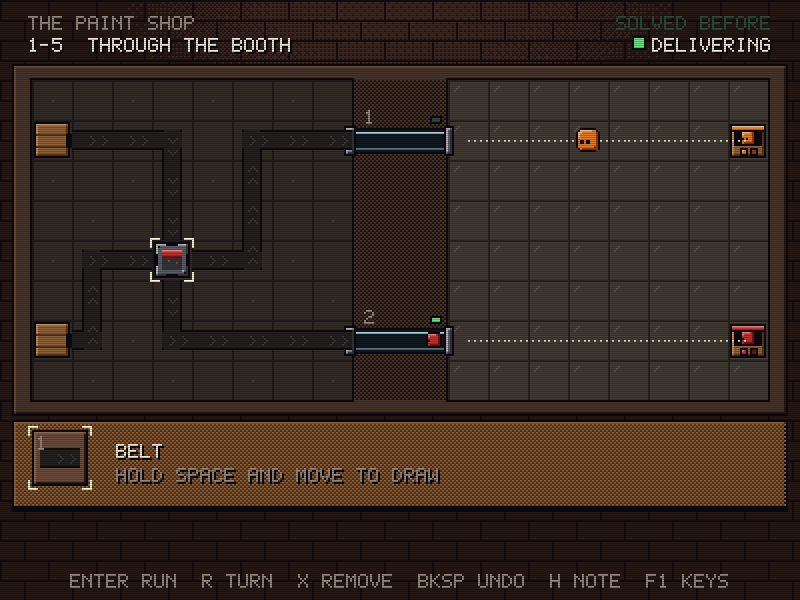

# Chuteworks: prototype of halls 1 and 2

A playable slice of the design in [`docs/design.md`](docs/design.md): **The Paint Shop** and **The Switchyard**, 8 rooms each. You lay belts and machines on the left board, press Enter, and the factory fills the glass chutes between the boards. Then the chutes take turns dropping items onto the right board, where they slide into bins. Rendering follows [`../AGENTS.md`](../AGENTS.md): 400x300 indexed 64-color VGA palette, exact integer scaling, F2 scanlines, 15 FPS ticks with 250 Hz input latching.



## Run

```bash
cargo run --release
```

```bash
cargo run --release -- --windowed
```

Progress is saved to `chuteworks_save.txt` in the working directory (gitignored).

## Controls

| Key | Action |
| :-- | :-- |
| Arrows / WASD | Move the cursor. It crosses from the left board to the right board |
| Space / left click | Place the picked part. With the belt, hold and move to draw; back up to erase; tap a belt to turn it |
| R / mouse wheel | Turn the part under the cursor |
| T | Flip a switch lever, or which side a zipper takes first |
| X / Delete / right click | Remove |
| 1-9, Q, E / click the shelf | Pick a part |
| Backspace / U | Undo |
| Enter | Run, stop, or go to the next room |
| F | Fast |
| H | The foreman's note for this room |
| Tab | Jump to the other board |
| F1 | Keys |
| F2 | CRT scanlines on/off |
| Esc | Back to the halls (or quit from there) |

## Rules

- **Make (left).** Crates emit their items, in order, onto belts; items move one tile per beat and queue. Belts can't cross or merge; two lines can cross only inside a booth, where both get painted. Paint adds up (red + yellow = orange), and a third primary makes mud. A **switch** deals items to its two lever sides in turn. A **zipper** takes from its two inputs in turn, starting with the lit side, and drains the other side once one runs dry.
- **Chutes.** Each line that reaches a hatch fills that chute, first in, first out.
- **Deliver (right).** Chutes take turns from the top. Only one item is on the floor at a time, sliding until an **arrow** turns it. The same **switch** on the floor is a flip-flop. Booths work on the floor too. Each bin wants one color.
- **Speed never matters.** What reaches each chute, and in what order, depends only on the layout.
- Change only the right board after a run and Enter re-delivers the same chute contents without making them again.
- Jams and failures stop the run and mark the tile (red brackets) with a short reason. The chalk dots on the floor show where each item went.

## Rooms

| Room | Point |
| :-- | :-- |
| 1-1 First Coat | A line paints everything that rides it |
| 1-2 Two Coats | Paint adds up |
| 1-3 Slide | On the floor, things slide until something turns them |
| 1-4 Two Chutes | Chutes take turns; floor paths may share tiles |
| 1-5 Through the Booth | Belts can't cross, except inside a booth |
| 1-6 Mud | Cross in the booth whose color you already have |
| 1-7 Floor Paint | Booths work on the floor too |
| 1-8 Backwards | The floor decides which chute must carry which color |
| 2-1 Switch | A switch deals in turn |
| 2-2 Split Before You Paint | Split first, then make the halves different |
| 2-3 Flip-Flop | The same switch on the floor |
| 2-4 Turn Taking | Two chutes weave for free |
| 2-5 Wrong Foot | The top chute goes first; weave it yourself to start differently |
| 2-6 Swap Pairs | A switch into a zipper that starts on the other side swaps each pair |
| 2-7 Other Board | The floor can split and paint too |
| 2-8 Blue Goes First | Split, paint, then weave in the order the floor needs |

## Files

- `levels/*.lvl`: each room as plain text: two 8x8 grids, crates, chutes, bins, the shelf, and a stored solution (`solve:` lines).
- `src/sim.rs`: the rules, Make and Deliver, headless.
- `src/game.rs`: editing, undo, runs, progress. `src/render.rs`, `src/sprites.rs`, `src/palette.rs`: drawing. `src/audio.rs`: synthesized sound effects through waveOut.

## Tests and screenshots

```bash
cargo test
```

The tests run every room's stored solution to a win and check that an empty board doesn't win. They check that solutions use exactly the shelf, on free tiles of allowed boards. They play the planned wrong first attempts (straight lines in *Through the Booth*, one color per chute in *Wrong Foot*, crossing in the red booth in *Mud*, splitting on the belts in *Other Board*) and check each fails the intended way. They also drive the editor through key presses.

```bash
cargo run --release -- --export-screenshots screenshots
```
