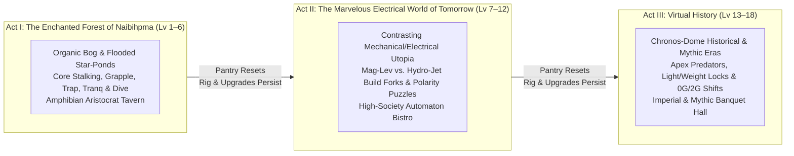

# 18-Level Campaign & Metroidvania Progression Blueprint

This blueprint structures the **18 hand-designed levels** in the updated three-album campaign order (**Act I: *Naibihpma*** $\rightarrow$ **Act II: *The Marvelous Electrical World of Tomorrow*** $\rightarrow$ **Act III: *Virtual History***), incorporating the exact Bandcamp track titles and durations, musical cues from listening to all 18 tracks, the ***Dave the Diver* $\text{O}_2$-is-Health/Timer economy**, **Metroidvania movement additions & removals**, and **interlocking, mutually-exclusive level routes**.

---

## 1. Core Systemic Pillars (How Stakes & Novelty Escalate)

### A. The *Dave the Diver* $\text{O}_2$-is-Health & Song-Length Pacing Economy
* **One Unified Survival Bar ($\text{O}_2$):** Your alien foraging suit relies on a sealed **$\text{O}_2$ Tank** in all three acts (filtering toxic spores in *Naibihpma*, high-voltage ozone/vacuum in *Electrical World*, and chrono-dome pressure in *Virtual History*).
* **Tuned to Track Duration (`1.1x–1.25x` Song Length):**
  * Passive $\text{O}_2$ drain is calibrated so a baseline tank lasts slightly longer than that stage's music track (e.g., ~`3:45` on intense 3-minute tracks like *Transformer Junction No. 9* [`03:11`] and *A Myth* [`03:08`]; ~`5:30–6:00` on standard 4–5 minute tracks; and ~`8:00` on epic finales like *The Great Transoceanic Railway* [`06:37`] and *Posthistory* [`07:16`]).
  * **Actions & Weight Cost $\text{O}_2$:** Diving deep, winching while near max cargo (`kg`), or firing high-draw rig modules accelerates $\text{O}_2$ consumption.
  * **Damage = Instant $\text{O}_2$ Rupture:** Enemy attacks and environmental hazards (Gorf's hex-orbs, Voltaic Eel shocks, arc-bus discharges, Smilodon pounces) do not hit a separate HP bar—they **puncture your suit pressure and vent `-15` to `-30` $\text{O}_2$** on impact.
  * **Player Control via Pickups & Upgrades:** Stages feature risk/reward **$\text{O}_2$ Rechargers** (Bioluminescent Bubble-Reeds, Pressurized Air-Valves, Sunken Amphora Air-Pockets) tucked along dangerous side-routes, while **Tank Capacity & Regulator Upgrades** let players extend their dive well past the song's first loop to hunt secret `3*` ingredients.
  * **Blackout Penalty:** Hitting `0` $\text{O}_2$ triggers emergency extraction—you survive, **but lose all harvested items from that stage except `1` single ingredient**, forcing a desperate Night Service.

---

### B. Metroidvania Movement Evolution (Additions, Loadout Forks & Temporary Stripping)
Rather than using a static moveset for 18 levels, movement and traversal rules **expand, branch into mutually-exclusive rig loadouts, and get temporarily stripped or inverted** by stage gimmicks and heavy carried objects:

| Phase / Source | Movement / Traversal Change | What It Enables (and What It Takes Away) |
| :--- | :--- | :--- |
| **Lv 1–4 Baseline** | **Stealth Walk + Auto-Crawl + Auto-Gap-Leap $\rightarrow$ Grapple-Winch (`Lv 2`) $\rightarrow$ Lure-Stealth (`Lv 3`) $\rightarrow$ 8-Way Diving (`Lv 4`)** | Builds the core 4-tool vocabulary one stage at a time before twisting the rules in Lv 5. |
| **Chassis Fork A** *(Unlocked in Act II)* | **Mag-Lev Iron Boots** *(Mutually exclusive with Hydro-Jet Pack)* | **Adds:** Walk up vertical steel/porcelain walls, cross live electrified rails, and auto-leap `5`-tile magnetic gaps. **Takes Away:** You **sink like lead in water** (disables free 8-way upward swimming; underwater you walk on the seabed like *Castlevania/Mega Man* iron boots and must winch up via overhead grapple rings). |
| **Chassis Fork B** *(Unlocked in Act II)* | **Hydro-Jet Thruster Pack** *(Mutually exclusive with Mag-Lev Boots)* | **Adds:** High-speed directional **Jet-Dash** underwater (piercing strong turbine currents) and a horizontal **Air-Boost** across wide chasms. **Takes Away:** Repelled by magnetic/high-voltage floors; cannot climb vertical steel shafts. |
| **Two-Handed Carryables** *(Lv 6, 9, 15, 18)* | **Relic Keys, Prism Lenses & Amphora Lanterns** | Holding a two-handed puzzle object (like the **Bioluminescent Lantern** in pitch-black sunken shipwrecks or **Reflector Prisms** in the Inventor Museum) **disables your Harpoon/Grapple-Winch and Tranq Gun** until you set the object down, forcing *Portal*-style placement puzzles. |
| **Environmental Stripping** *(Lv 5, 8, 11, 13, 16)* | **Cursed Mire, Slipstream Wind, Tar Pits & `0G`/`2G` Gravity Shifts** | Specific zones strip one movement verb to force mastery of another (e.g., **Binding Mire** in Lv 5 disables auto-gap-leap so you must chain ceiling grapple-rings; **Tar** in Lv 13 masks your scent from apex predators *at the cost of disabling gap-leaping*; **`2G` Heavy Gravity** in Lv 16 grounds all leaps while **`0G`** turns the entire room into 360° swimming). |

---

### C. Interlocking, Mutually-Exclusive Level Paths (*Dead Cells* / *Portal* / *Dishonored* Design)
Every stage from Level 2 onward is built around **interlocking spatial trade-offs** where taking or altering one route locks out another:
1. **World-State Switches (Flooding / Draining / Counterweights):** Opening a sluice gate to flood a dry lower chamber lets you swim across to a sunken `3*` treasure alcove, **but drowns the dry root-burrows** in that chamber so land-based skittish creatures vanish for the rest of the dive.
2. **Acoustic / Stealth Propagation:** Firing the loud Pneumatic Harpoon (`[X]`) to smash a brittle shortcut wall alerts skittish or aggressive fauna in adjacent rooms, whereas taking the longer stealth ventilation shaft preserves `3*` tranquilizer/trap opportunities.
3. **Time/$\text{O}_2$ vs. Weight Commitment:** Each stage has two primary biome branches (e.g., **High Canopy / Skybridge** vs. **Deep Basin / Undercity**) plus a **Hazardous Blueprint Vault**. Because your $\text{O}_2$ is paced to the song and your bag holds limited `kg`, you must pick your route based on **tonight's Patron Cravings** and **your equipped Rig Chassis**.

---

## 2. Act I (Levels 1–6): *The Enchanted Forest of Naibihpma*
* **Musical Vibe (from audio):** Ethereal theremin/flute leads, nocturnal crickets, hypnotic marimba/kalimba arpeggios, liquid filter squelches, baroque harpsichord-synth counterpoint, and deep cathedral drones.
* **Tavern & Stakes:** **The Hollow-Root Bog Tavern** (2-ingredient dishes; forgiving amphibian patrons; introduces Pre-Service Dish Pairing, Tea pouring, and initial Rig/Tavern upgrades).

| Lv | Track & Duration | Musical Mood & Pacing Target | Level Design, Obstacles, Enemies & Interlocking Paths |
| :--- | :--- | :--- | :--- |
| **1** | **The Underbrush** `05:52` *(Target $\text{O}_2$: ~6:30)* | Hushed, mournful portamento flute over night insects & bell chimes; slow, atmospheric exploration. | **The Twilight Bog Terrace (Onboarding):** • **Mechanics:** Grounded stealth-walk, auto-crawling `1–2` tile roots, auto-leaping `1–3` tile crevices, and `[X]` Pneumatic Harpoon. • **Interlocking Choice:** Upper dry terrace has easy `2*` **Violet Spore-Lotuses**; lower bramble tunnel has **Glow-Grubs** guarded by spore-puff vents that cost `-10` $\text{O}_2$ if rushed. |
| **2** | **Daot the Enchanter** `04:30` *(Target $\text{O}_2$: ~5:15)* | Hypnotic plucked marimba/kalimba groove with a steady electronic pulse and echoing bell droplets. | **Daot's Enchanted Stone Piers:** • **New Gear:** Unlocks **Overhead Grapple-Winch (`[UP]+[X]`)** and **Soporific Tranq Darts (`[Z]/[SPACE]`)**. • **Enemy/Puzzle:** **Daot's Enchanter Toads** project rhythmic spore-shields synced to the pulse—raw harpoons ricochet off them. You must grapple to flanking ledges or time a Tranq Dart when they inhale. • **Mutually-Exclusive Path:** Dropping the hollow-log drawbridge to cross the chasm crushes the lower **Cave-Morel** grotto. |
| **3** | **Twen, Dew Collector** `04:48` *(Target $\text{O}_2$: ~5:30)* | Shimmering high strings, water-drop chimes, and a playful, tiptoeing woodwind/synth-bass ostinato. | **The Canopy Dew-Bridges (Stealth & Trapping):** • **New Gear:** Unlocks **Bioluminescent Bait-Net Trap (`[C]`)** and **Shadow Concealment** (standing in dark hollow-tree alcoves hides you from sightlines). • **Enemy/Puzzle:** **Twen Dew-Newts** harvest dew drops along high vines; if they see you walking upright or hear a harpoon shot, they bolt into burrows. You must place a `[C]` lure, grapple up into a canopy shadow, and wait for them to feed (`3*`). |
| **4** | **Star Pond** `04:10` *(Target $\text{O}_2$: ~5:00)* | Cascading crystalline harp arpeggios and liquid, resonant low-pass filter squelches. | **The Flooded Star-Pond Basin (Amphibious Hub):** • **New Movement:** Unlocks **8-Way Buoyant Diving**, pier clambering, and underwater **Bubble-Reed $\text{O}_2$ Vents**. • **Enemy/Puzzle:** **Voltaic Reed-Eels** patrol submerged gates, cycling electric discharges (touching them while charged vents `-20` $\text{O}_2$; capturing one **ionizes** your whole backpack for $+40\%$ dish value). • **Interlocking Path:** Pulling the sunken root-plug drains the upper pond (making the **Golden Lotus** walkable) while flooding the lower eel cavern. |
| **5** | **Gorf, Dark Sorcerer** `04:51` *(Target $\text{O}_2$: ~5:30)* | Swirling, ominous baroque-synth arpeggios with growling resonant bass sweeps and eerie choir pads. | **Gorf's Sunken Bastion (Movement-Stripping Twist!):** • **Movement Twist — *Binding Mire*:** Gorf has cursed the bastion floors with purple mire that **disables auto-gap-leaping and halves walking speed**. • **Puzzle/Enemy:** **Gorf's Sorcerer Bullfrogs** fire slow homing hex-orbs that invert your controls briefly on hit. To cross the mire chambers without losing $\text{O}_2$, you must chain **overhead Grapple-Rings across the ceiling** and drop `[C]` traps onto raised stone pedestals from above. |
| **6** | **Ancient Magic** `04:25` *(Target $\text{O}_2$: ~5:15)* | Vast, solemn cathedral organ/pad drones, sub-bass rumbles, and high bell tones; sacred and tense. | **Sanctuary of the Elder Root (Act I Finale):** • **Movement Addition & Weight Lock:** Unlocks **Horizontal Wall-Grapple Pulling**, but to open the inner sanctum you must carry the **Ancient Amber Idol**—a two-handed relic that **disables your Harpoon/Tranq while held** and makes you sink in water. • **Finale:** You must toss, grapple-retrieve, and ferry the Idol through flooded and vertical puzzle rooms to harvest the **Royal Elder-Roe**, followed by the **Act I Elder Council Banquet**! |

---

## 3. Act II (Levels 7–12): *The Marvelous Electrical World of Tomorrow*
* **Musical Vibe (from audio):** Retro-futuristic analog synth brass, fluttering bell arpeggios, melancholic midnight harpsichord/clavinet counterpoint, sweeping museum filter-lights, and driving locomotive/acid-bass rhythms.
* **Between-Act Transition:** Your organic bog ingredients clear out as your ship docks at an **abandoned retro-futuristic World's Fair utopia city**. You unlock the **Chassis Hardpoint Fork** (**Mag-Lev Iron Boots** vs. **Hydro-Jet Thruster Pack**).
* **Tavern & Escalating Stakes:** **The High-Voltage Automaton Bistro**, serving **sophisticated porcelain-and-brass robot aristocrats**. Dishes now have **Charge/Thermal Decay** on the kitchen pass (requiring better timing or the **Capacitor Warmer** upgrade), and VIP Automaton Critics penalize your **Reputation** if kept waiting!

| Lv | Track & Duration | Musical Mood & Pacing Target | Level Design, Obstacles, Enemies & Interlocking Paths |
| :--- | :--- | :--- | :--- |
| **7** | **The Corner of Maple St. and the Future** `04:49` *(Target $\text{O}_2$: ~5:30)* | Nostalgic analog brass melody over warm chords and fluttering bird-like synth chimes; dusk on a retro-future street. | **Cobblestone Suburbia & Glass Domes (Chassis Fork Intro):** • **Setting:** Rain-slicked cobblestone streets and glowing streetlamps leading into floating glass biodomes. • **Interlocking Build Paths:**   – *Mag-Lev Route:* Walk up the vertical cast-iron streetlamp towers and across live overhead powerlines to harvest **Warm Nixie-Bulbs** and **Copper-Coil Scarabs**.   – *Hydro-Jet Route:* Dive into the flooded subterranean utility canals beneath Maple St., jet-dashing past steam-turbines for **Dielectric Pearl-Clams**. |
| **8** | **The Late Shuttle Home** `05:30` *(Target $\text{O}_2$: ~6:15)* | Melancholic baroque clavinet/harpsichord counterpoint over drifting nocturnal pads; lonely midnight transit. | **The Midnight Sky-Shuttle (Moving Train & Wind Twist!):** • **Movement Twist — *High-Altitude Slipstream*:** Set aboard a multi-deck automated sky-shuttle gliding through the night. Stepping onto the **exterior roof decks** exposes you to gale-force slipstream wind that **pushes you backward unless you stay in a low crawl or grapple-tethered**! • **Stealth/Puzzle:** Inside the passenger cars, **Sleepwalking Steward-Bots** patrol with search-visors; you must use under-floor maintenance ducts and exterior hull-clinging to harvest **Cryo-Berry Gin** and **Gold-Leaf Vacuum Tubes**. |
| **9** | **The Lights Above Inventor Museum** `04:48` *(Target $\text{O}_2$: ~5:30)* | Deep resonant bass plucks, sweeping aurora filter washes, and rapid modular arpeggios dancing overhead. | **The Inventor's Hall of Light (*Portal*-Style Beam & Stealth Puzzles):** • **Puzzle Mechanic:** Sweeping **Security Searchlights** and **Photo-Electric Laser Gates** crisscross the museum domes. Firing a harpoon or stepping into a searchlight triggers **Defense Turrets** (`-25` $\text{O}_2$). • **Two-Handed Carryable:** You must pick up and place **Refractive Glass Prisms** (disabling your weapons while carried) to bend the ceiling light beams into **Solar-Capacitor Flowers**, causing them to bloom into `3*` **Radiant Filament-Saffron** while simultaneously unlocking shadow corridors! |
| **10** | **Transformer Junction No. 9** `03:11` *(Target $\text{O}_2$: ~3:45)* | Electric zaps, bubbling sample-and-hold synths, and a driving, high-tempo chugging rhythm at 0:50! | **The Rhythmic Switching Yard (Short, High-Intensity Sprint!):** • **Pacing:** Only `03:11`—a tight, adrenaline-fueled puzzle-sprint! • **World-State Mechanic — *Red/Blue Polarity Bus*:** Synced to the chugging beat (and toggled manually via **Knife-Switch Levers**), the entire junction alternates between **Red (`+`)** and **Blue (`-`)** polarity. Flipping the switch to de-energize the Blue grapple-shafts so you can climb to the **Tesla-Tortoise Nest** simultaneously **electrifies the Red coolant pool** below! |
| **11** | **Starbridge** `03:55` *(Target $\text{O}_2$: ~4:30)* | Majestic cathedral synth-brass fanfare dissolving into weightless, shimmering high-altitude bell droplets. | **The Stratosphere Suspension Span (Low-G & Vacuum Drain Twist!):** • **Movement Twist — *Thin Atmosphere (`0.5G` + `2.5x` $\text{O}_2$ Drain)*:** Crossing the colossal suspension bridge between two orbital tether-towers. Outside the pressurized glass sentry-pods, **low gravity doubles your auto-leap distance (`6` tiles)**, **tranq darts fly in flat laser-straight lines**, and **vacuum exposure drains $\text{O}_2$ `2.5x` faster**! • **Gameplay:** A tense chain of high-flying grapple-swings from pressurized pod to pressurized pod to capture sky-dwelling **Corona-Ray Mantas**. |
| **12** | **The Great Transoceanic Railway** `06:37` *(Target $\text{O}_2$: ~7:30)* | Relentless, chugging acid-bass locomotive groove with wailing synth train-whistles and driving brass! | **The Abyssal Express (Act II Marathon Finale!):** • **Setting & Structure:** A `06:37` epic horizontal-and-vertical gauntlet aboard a massive **submerged glass-tube express train** speeding across the ocean trench floor! • **Interlocking Progression:** You start at the rear caboose and must advance through **8 distinct cars**—some dry and guarded by **Armored Conductor-Automatons**, some breached and half-flooded, and some requiring you to **exit an airlock and swim/grapple along the exterior hull** in the roaring slipstream—culminating in the **Locomotive Core Harvest** and the **Grand Automaton Gala Service**! |

---

## 4. Act III (Levels 13–18): *Virtual History*
* **Musical Vibe (from audio):** The most rhythmic and percussive album—hand-drums, woodblocks, prowling real bass guitar, acoustic/nylon guitar & harp grooves, sitar & tabla rhythms, ticking telemetry percussion, mournful pitch-bending solo strings, and a 7-minute symphonic-electronic finale.
* **Between-Act Transition:** Entering **The Chronos-Dome Culinary Biosphere**, your synthetic robot components clear out. You now forage for **authentic historical & mythological real-world foods** across 6 reconstructed epochs of history.
* **Tavern & Maximum Stakes:** **The Chronos Imperial Banquet Hall**, serving **Emperors, Time-Travelers, and Mythic Deities**. Patrons now order **3-Ingredient Masterpiece Dishes** (`Starter + Main + Glaze`), rival predators in the field can **steal trapped prey** if you don't retrieve it promptly, and every night is a high-stakes test of your full 18-level build!

| Lv | Track & Duration | Musical Mood & Pacing Target | Level Design, Obstacles, Enemies & Interlocking Paths |
| :--- | :--- | :--- | :--- |
| **13** | **Prehistory** `05:02` *(Target $\text{O}_2$: ~5:45)* | Gong crash, polyrhythmic hand-drums, prowling bass guitar, marimba chimes, and breathy pan-flute. | **Pleistocene Fern-Canyon (Apex Predator & Scent-Stealth Twist!):** • **Enemy Twist — *You Are Hunted*:** Giant **Sabre-Cat Stalkers** and **Raptor-Birds** actively sniff out your scent trail if you move upright or carry raw meat (`Bristle-Boarlet`). • **Movement Trade-off:** Wading through **Warm Tar-Mud Springs** coats your suit, making you **invisible to predator scent (`100%` stealth)**—**but** the heavy tar **disables auto-gap-leaping and slows grapple-winching** until you dive into a subterranean cenote pool (where **Armored Coelacanths** swim) to wash it off! |
| **14** | **Iron Age** *(Stone Age on Bandcamp)* `05:19` *(Target $\text{O}_2$: ~6:00)* | Urgent minor-key acoustic guitar & harp arpeggios, crisp percussion, and a funky fretless bass breakdown. | **The Counterweight Citadel (*Prince of Persia* Trap & Gate Puzzles):** • **Terrain Puzzles:** A vertical fortress of stone aqueducts, spiked counterweight portcullises, and swinging bronze pendulums. • **Interlocking Commitment:** Harpooning the **Bronze Counterweight Chains** to lower the cage holding the `3*` **Royal Highland Stag / Truffle-Boar** permanently **drops the portcullis on the upper aqueduct**, forcing you to escape through the flooded lower catacomb traps under a tight $\text{O}_2$ clock! |
| **15** | **Golden Age** `04:33` *(Target $\text{O}_2$: ~5:15)* | Tabla hand-percussion and plucked sitar/oud strings over a warm bass-guitar pulse and regal reed lead. | **Marble Colonnade & The Dark Trireme Abyss (Light-Lantern Puzzle):** • **Dual-Layer Stage:** Above water is a sunlit classical garden (**Golden Saffron-Figs** & **Marble-Roosting Peacocks**); below is a **pitch-black sunken spice-shipwreck**. • **Equipment Lock:** To see traps, venomous morays, and `3*` **Aged Amphora Garum / Aegean Octopus** in the dark wreck, you must carry a **Phosphor-Bronze Lantern**—which **locks out your Harpoon and Tranq Gun while held**. You must set the lantern on sunken column pedestals to illuminate a zone, hunt within its radius, and pick it back up! |
| **16** | **Space Age** `06:27` *(Target $\text{O}_2$: ~7:15)* | Crisp ticking telemetry percussion, warm electric piano chords, pulsing bass, and soaring cosmic flute leads. | **The Centrifugal Gravity Ring (`1G` / `0G` / `2G` Gravity Cycling!):** • **Movement Twist — *Centrifuge Rotations*:** A massive `06:27` orbital agricultural ring whose artificial gravity cycles (or can be manually overridden at **Telemetry Terminals**):   – **`1G` Standard:** Normal stealth-stalking and grapple-winching.   – **`0G` Free-Fall:** Gravity shuts off—**the entire dry level becomes 8-way buoyant flight**, letting you float up into ceiling hydroponic domes for **Orbital Marbled-Wagyu** and **Zero-G Tang-Citrus**!   – **`2G` Heavy Crush:** All airborne leaping is disabled and flying drones are slammed to the floor (making them easy `3*` captures), while deep pressurized aquaculture gates pop open! |
| **17** | **A Myth** `03:08` *(Target $\text{O}_2$: ~3:40)* | Hypnotic kalimba ostinato with a mournful, crying pitch-bent violin/erhu lead and slow ritual drums. | **Labyrinth of the Gorgon (Short, High-Stakes Stealth Boss Stage!):** • **Pacing & Stakes:** Only `03:08`—an intimate, nerve-wracking mythic trial inspired by *Age of Mythology*. • **Boss Hazard:** A single immortal **Bronze Gorgon** patrols the terraced marble sanctuary. If her **Petrifying Gaze** catches you in open sightlines, your suit joints freeze (`-25` $\text{O}_2$ and `3` seconds of lost grapple/leap mobility). • **Puzzle:** You must use **Polished Aegis-Mirrors** and `[C]` **Ambrosia Lure-Traps** to distract her gaze while harvesting the **Golden Hesperides Apple**, **Kraken Tentacle**, and **Nectar Comb**. |
| **18** | **Posthistory** `07:16` *(Target $\text{O}_2$: ~8:15)* | Deep, elegiac sliding cello/string ensemble harmonies (`0:00–1:05`) erupting into rapid crystalline arpeggios! | **The Convergence Biosphere (7:16 Ultimate Campaign Finale!):** • **Two-Part Musical Structure:**   – *Part 1 (`0:00–1:05` String Elegy):* You descend through a quiet, sunken cathedral of overgrown skyscrapers and classical columns where **Temporal Rifts** flicker.   – *Part 2 (`1:05–7:16` Crystalline Arpeggio Surge):* The Chronos Core destabilizes! Adjacent chambers shift between **all three Acts' rules** (*Naibihpma* Binding Mire & Voltaic Eels, *Electrical World* Red/Blue Polarity Rails & Searchlights, and *Virtual History* `0G` Gravity Pockets & Apex Predators). • **Grand Finale:** Using every upgrade and technique mastered across the 18 stages, you extract the **Primeval Chrono-Truffle** and serve the **Final 4-Course Banquet at the End of Time**! |
