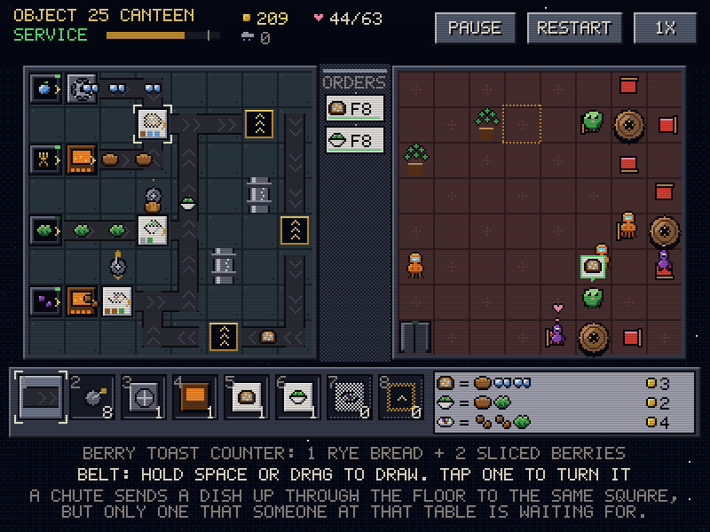

# Mise en Space: prototype of the Object 25 Canteen

A small, live, Factorio-style restaurant on an ice planetoid. The **left board is the kitchen**: pantry hatches put out ingredients, and you lay belts, grabber arms, a slicer, ovens and plating counters to cook them into dishes. The **right board is the dining room**: alien guests walk in, sit, order, wait, eat, pay and leave. A **chute** on a kitchen square sends a dish up through the floor to the **same square** in the dining room, but only if someone at that table ordered it.

Rendering follows [`../AGENTS.md`](../AGENTS.md): 400x300 indexed 64-color VGA palette, exact integer scaling, F2 scanlines, 15 FPS ticks with 250 Hz input latching. The mouse pointer is a hardware cursor built from the same pixel art. The background music is *Star 2 Object 25* from *Stellar Cartography*; it loops quietly, and nothing in the game listens to it.



## Run

```bash
cargo run --release -- --windowed
```

Without `--windowed` it runs fullscreen. The music is looked for in `assets/music/` next to the exe or the working directory, then in the Desktop masters; pass `--music <file.wav>` to choose one, or `--no-music`. Your best star count is saved to `misenspace_save.txt` (gitignored).

## Controls

| Key | Action |
| :-- | :-- |
| Arrows / WASD | Move the cursor. It crosses from the kitchen into the dining room; the same square in the other room is outlined |
| Space / left click | Place the picked part. With the belt, hold and move (or drag) to draw; back up to erase; tap a belt to turn it |
| R / mouse wheel | Turn the part under the cursor |
| X / Delete / right click | Remove |
| 1-8, Q, E / click the shelf | Pick a part |
| Backspace / U, C | Undo; clear the kitchen |
| Enter / OPEN button | Open the doors, pause, go on, or start another evening |
| F5 / RESTART button | Restart the evening (the kitchen stays as built) |
| F / speed button | 1x, 2x, 4x |
| Tab | Jump to the other room |
| F1 | How the kitchen works, and the keys |
| F2 | CRT scanlines on/off |
| Esc | Pause; press again to quit |

You can build at any time, including mid-service.

## Rules

- **Hatches** put out one ingredient every few beats onto the tile in front, when there's room. **Belts** carry items one tile per beat and back up when blocked; a completely full loop keeps turning.
- **Stations are stops on a line**, like a sushi belt. Machines and counters let through what they never use; anything they do use waits for room. The slicer turns frostberries into sliced berries. The oven turns ice-rye into bread and pulsar beans into roast beans.
- **Counters plate to order.** A counter gathers its parts, but plates a dish only when a guest has ordered one that isn't already on its way. Open orders hang on the **ticket rail** between the rooms, with their table and how patient the guest still is.
- **Grabber arms** lift from the tile behind and set down in front. They only load a station with what it will use, so they work as filters and splitters.
- **Chutes go under tables.** A chute sends up a dish someone at its table is waiting for and lets every other dish roll by. A loop of belts through the chutes is a natural way to serve several tables.
- **Guests** take the nearest free seat and order from tonight's menu (bean plates join partway through). They pay the dish's price plus up to 2 coins tip for speed. A guest who waits too long leaves hungry.
- **Stars** at closing time: fed 50%, 75% and 92% of the evening's 63 guests.

## Files

- `src/sim.rs`: the restaurant, one beat at a time (kitchen, chutes, guests). `sim::lab` has a text format for kitchen layouts and the reference kitchen used to check the level.
- `src/model.rs`: food, recipes, machines, cells, and the Object 25 Canteen (layouts, shelf, the evening's arrivals and menu).
- `src/game.rs`: building, undo, phases (prep, service, closing), sound cues. `src/render.rs`, `src/sprites.rs`, `src/palette.rs`: drawing. `src/audio.rs`: background music and synthesized effects through waveOut.
- [`docs/kitchen_design.md`](docs/kitchen_design.md): the redesign that led here.

## Tests and screenshots

```bash
cargo test
```

The tests cover belts, stations, arms, full loops and plating to order. They check that a reference kitchen earns 3 stars while an empty one feeds nobody, and drive building and a whole evening through the game layer.

```bash
cargo run --release -- --export-screenshots screenshots
```
