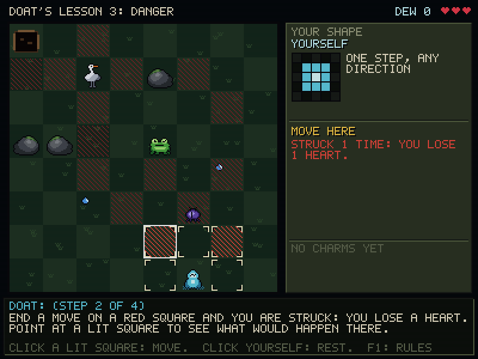
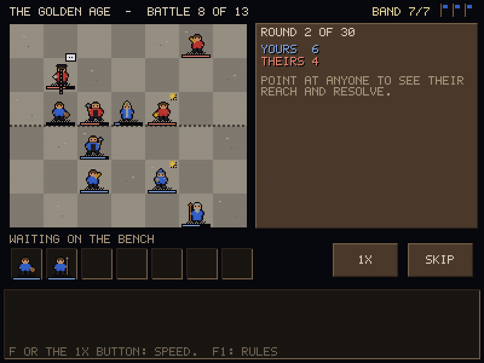

# Two roguelikes: Changeling and Turncoat

Two contrasting roguelike prototypes behind one launcher, built to find a direction through play. Each run ends with an in-game feedback form, and the answers go into `playtest_log.txt` together with a log of the run. The design, the reasoning behind it, and what each game tests are in [`docs/design.md`](docs/design.md).

- **A: CHANGELING.** One piece on an 8x8 board in the forest of Naibihpma. You move like the last creature you caught. Every creature moves and strikes with its own shape, and red squares show where you'd be struck. 10 burrows over 3 areas, then Grof. Music: *The Enchanted Forest of Naibihpma*.
- **B: TURNCOAT.** Place your band against a visible rival formation, then watch. Whoever runs out of resolve joins the side that won them over. 13 battles across the ages of history. Music: *Virtual History*.

Both games teach themselves (lessons on the first run, and again whenever the lesson version goes up), follow [`../AGENTS.md`](../AGENTS.md) (400x300, 64-colour VGA palettes, exact integer scaling, F2 scanlines, 15 FPS with 250 Hz input, a hardware pixel-art pointer), and stream music from the album masters on the Desktop. The music sits about 3 dB lower than in the earlier prototypes and the effects about 4 dB higher. F3 steps the music through HIGH, MEDIUM, LOW and OFF.






## Run

```bash
cargo run --release -- --windowed
```

Without `--windowed` it runs fullscreen. `--no-music` turns the music off. Music is looked for in `assets/music/` next to the exe or the working directory, then in `C:\Users\User\Desktop\albums`.

Local files (gitignored): `roguelikes_save.txt` (runs played, lessons seen, music level, scanlines) and `playtest_log.txt` (every run, turn by turn, followed by the form answers).

## Keys

| Key | Changeling | Turncoat |
| :-- | :-- | :-- |
| Mouse | point to inspect, click a lit square to move, click yourself to rest | drag people onto the field, right-click to send one back, point to see reach |
| Arrows + Enter | move the square cursor and act | choose routes |
| R | rest | |
| F | | battle speed 1x / 2x / 4x |
| F1 | rules | rules |
| F2 / F3 | scanlines / music level | scanlines / music level |
| Esc | pause: keep playing, end the run (and rate it), or quit | same |

## Tests and screenshots

```bash
cargo test --release
cargo run --release -- --export-screenshots screenshots
```

The tests cover shapes, line blocking, strikes and the exact move preview, creature AI (including the wary heron), spawns, Pounce and Shell, Grof's three catches, fair turn-one generation for every burrow, battle termination, turning, Priests holding, Heralds' columns, veterans, and the feedback form. Bots play whole runs of both games, lessons included, to check that every state is reachable and to estimate difficulty (see the balance notes in the design doc).

## Files

- `src/app.rs`: launcher, pause menu, save file, playtest log. `src/form.rs`: the feedback form. `src/main.rs`: window, input, presentation.
- `src/audio.rs`: track table (all from the albums), waveOut streaming with looping and fade-in, synthesized effects.
- `src/changeling/`: `rules.rs` (pure simulation and preview), `gen.rs` (burrows, areas, lessons), `mod.rs` (game flow), `render.rs`, `art.rs`.
- `src/turncoat/`: `data.rs` (people, ideas, ages), `battle.rs` (pure simulation), `mod.rs` (game flow), `render.rs`, `art.rs`.
