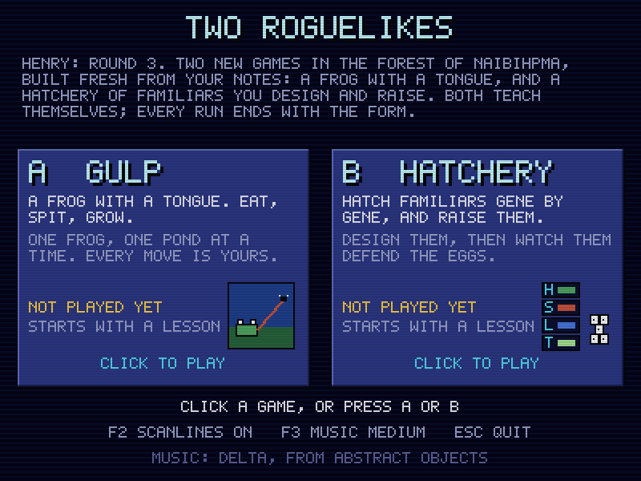
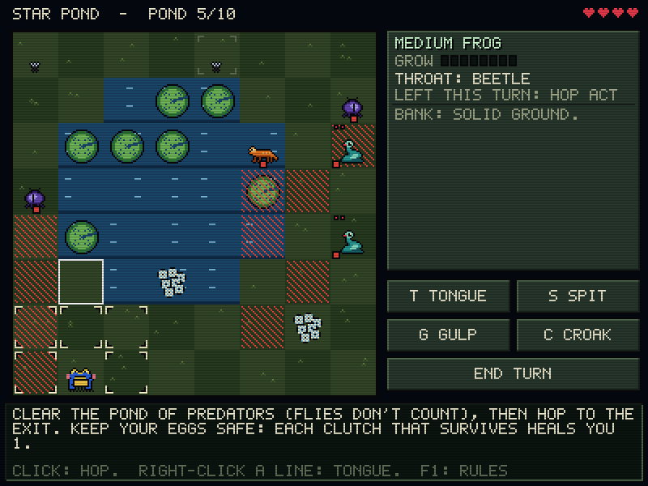
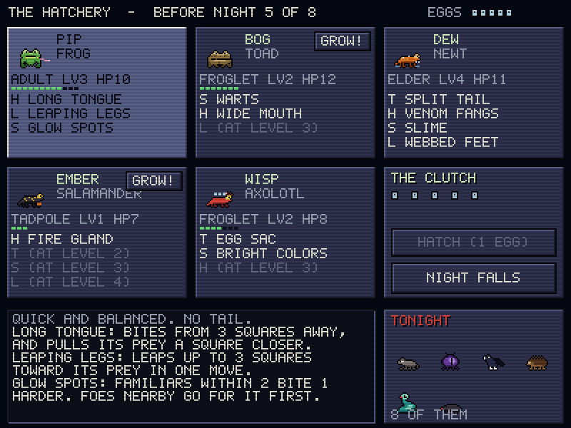
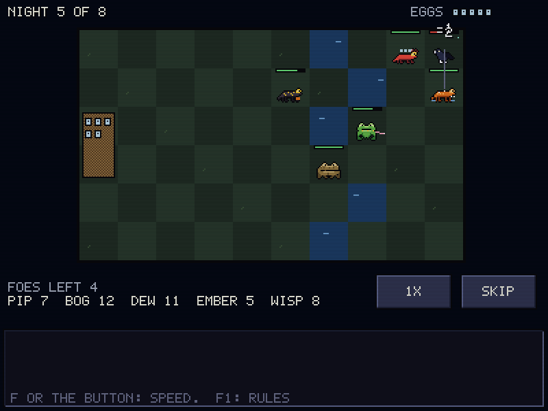

# Two roguelikes: GULP and HATCHERY

Two contrasting roguelike prototypes behind one launcher, built to find a direction through play. Each run ends with an in-game feedback form; the answers go into `playtest_log.txt` with a log of the run. The design, the history of the earlier rounds, and what each game tests are in [`docs/design.md`](docs/design.md).

- **A: GULP.** One frog, one pond at a time. Hop, then tongue (swallow the small, yank your size, get pulled to the big), spit what you swallowed, croak to shove. Eat to grow. Predators telegraph their strikes and also go for your frogspawn; shove and yank them so their strikes land elsewhere.
- **B: HATCHERY.** Hatch familiars from a body and genes (head, skin, legs, tail), raise them through four stages, learn new genes from what they defeat, and watch them defend the eggs over 8 nights, the last one Grof's. Eggs are both your lives and the cost of hatching.

Both are set in the forest of Naibihpma, with music from *The Enchanted Forest of Naibihpma*. Both teach themselves (lessons on the first run, and again whenever the lesson version goes up) and follow [`../AGENTS.md`](../AGENTS.md): 400x300, 64-colour VGA palettes, exact integer scaling, F2 scanlines, 15 FPS with 250 Hz input, and a hardware pixel-art pointer. Sound effects are soft synthesized pond sounds, and the same effect can't restart within 70 ms. The music sits under the effects, and F3 steps its level.

Earlier rounds: round 1 (Changeling, Turncoat) is commit f870cdc; round 2 (Changeling v2, Conduit) is in `archive/round2/` (not compiled).









## Run

```bash
cargo run --release -- --windowed
```

Without `--windowed` it runs fullscreen; `--no-music` turns the music off. Music is looked for in `assets/music/` next to the exe or the working directory, then in `C:\Users\User\Desktop\albums`.

Local files (gitignored): `roguelikes_save.txt` (runs, lessons seen, music level, scanlines) and `playtest_log.txt` (every run, turn by turn, followed by the form answers).

## Keys

| Key | GULP | HATCHERY |
| :-- | :-- | :-- |
| Mouse | click a lit square to hop; right-click a square in line to tongue; click yourself to end the turn; point at anything | click buttons and cards; drag familiars onto the pond; point at anything |
| T / S / G / C | tongue / spit / gulp / croak | |
| Space, Enter | end the turn | start the night |
| F | | night speed 1x / 2x / 4x |
| F1 / F2 / F3 | rules / scanlines / music level | same |
| Esc | pause: keep playing, end the run (and rate it), or quit | same (or close a dialog) |

## Tests and screenshots

```bash
cargo test --release
cargo run --release -- --export-screenshots screenshots
```

The tests cover GULP's tongue (swallow, yank, grapple, drowning), spit and shoves, strikes landing where the striker stands, growth, lily pads sinking, charges into water, fair pond generation and the lessons; and Hatchery's growth into body slots, nights always ending, defenders mattering, and egg sacs. Bots play whole runs of both games, lessons included, to check every state is reachable and to estimate difficulty (see the balance notes in the design doc).

## Files

- `src/app.rs`: launcher, pause menu, save file, playtest log. `src/form.rs`: the feedback form. `src/main.rs`: window, input, presentation. `src/audio.rs`: album tracks, streaming, synthesized effects.
- `src/gulp/`: `rules.rs` (pure simulation and previews), `gen.rs` (ponds, areas, lessons), `mod.rs` (flow, input, bank), `render.rs`, `art.rs`.
- `src/hatchery/`: `data.rs` (bodies, genes, foes, familiars), `battle.rs` (pure tick simulation), `mod.rs` (hatchery, dialogs, nights, lesson), `render.rs` (including drawing familiars from their genes), `art.rs`.
